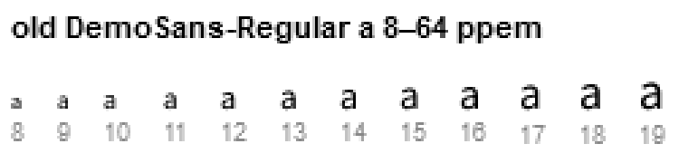

# hinting-diff

[](https://pypi.org/project/hinting-diff/)
[](https://pypi.org/project/hinting-diff/)
[](https://github.com/klim-type-foundry/hinting-diff/actions/workflows/check.yml)
[](https://github.com/klim-type-foundry/hinting-diff/blob/main/LICENSE.txt)

Compare the TrueType hinting of two versions of a font, or a family of fonts,
in a browser.

`hinting-diff` writes an HTML page that shows every glyph of a font, encoded or
not, rendered with its hinting at a size in pixels per em (ppem), for the old
and the new version of the font. Click **old**/**new** to switch between them
and see what changed. For a family, it writes a page for each font, and an index
page that links to them.



<sub>Source Sans Pro without hinting (old) and hinted with ttfautohint (new), in
Firefox on Windows 11, enlarged 3×.</sub>

Browsers only apply TrueType hinting on Windows, so open the page on Windows. It
works in old browsers too, as far back as Internet Explorer 11, Chrome 49 and
Firefox 52, for checking hinting on old versions of Windows.

## Install

```shell
pip install hinting-diff
```

It needs Python 3.10 or later, and installs
[fontTools](https://github.com/fonttools/fonttools) too.

To take screenshots of the pages (see [Screenshots](#screenshots)), install the
`screenshot` extra, which adds [Playwright](https://playwright.dev/python/) and
[Pillow](https://python-pillow.org):

```shell
pip install "hinting-diff[screenshot]"
```

## Usage

```shell
hinting-diff old/Family-Regular.ttf new/Family-Regular.ttf -o hinting-diff/
```

This writes `hinting-diff/Family-Regular-hinting.html`, with copies of both
fonts next to it, and prints the page's path. Open it in a browser on Windows.

To compare a family, give the folders of the old and the new fonts, or the fonts
with `-fb`/`--fonts-before` and `-fa`/`--fonts-after`, as in
[diffenator2](https://github.com/googlefonts/diffenator2):

```shell
hinting-diff old/ new/
hinting-diff -fb old/*.ttf -fa new/*.ttf
```

Fonts are matched by their file names, and folders' subfolders are searched too.
A font that's only in the old or only in the new fonts is skipped, with a
warning. This writes a page for each font, and an `index.html` page that links
to them, and prints their paths, with the index page last. A single old font and
a single new font, given on their own, are compared whatever their names.

If a font can't be read, the other fonts' pages are still written, and the
command exits with an error.

The output folder is optional, and is `hinting-diff` by default. All the
options:

```text
usage: 
  hinting-diff [-h] [-o OUT] [--screenshot ...] [--version] BEFORE AFTER
  hinting-diff [-h] [-o OUT] [--screenshot ...] [--version] -fb FONT [FONT ...] -fa FONT [FONT ...]
  hinting-diff [-h] [-o OUT] [--screenshot ...] [--version] AFTER [AFTER ...] --commit [REF]

Write pages to compare the TrueType hinting of two versions of fonts. Give the
old and new font, or folders of them, or several fonts with -fb and -fa: fonts
are matched by their file names. Or give the new fonts, or folders of them, in
a git repository, with --commit to compare them with the fonts at the same
paths in a commit. Browsers only apply TrueType hinting on Windows, so open
the pages on Windows, or take screenshots of them there with --screenshot.

positional arguments:
  BEFORE AFTER          the old and the new font (TTF), or folders of fonts.
                        With --commit, the new fonts or folders

options:
  -h, --help            show this help message and exit
  -fb FONT [FONT ...], --fonts-before FONT [FONT ...]
                        the old fonts (TTF), or folders of fonts
  -fa FONT [FONT ...], --fonts-after FONT [FONT ...]
                        the new fonts (TTF), or folders of fonts
  --commit [REF]        compare the new fonts with the fonts at the same paths
                        in this commit, e.g. HEAD~1 or a tag (default: HEAD,
                        the last commit)
  -o OUT, --out OUT, --output OUT
                        folder for the pages and copies of the fonts (default:
                        hinting-diff)
  --version             show program's version number and exit

screenshots:
  Take screenshots of each page in the old and the new font, in
  OUT/screenshots, with a screenshots.json file that lists them and whether
  they changed. Needs the "screenshot" extra, and only shows the hinting on
  Windows.

  --screenshot          take screenshots of the pages
  --screenshot-sizes MIN-MAX
                        sizes of the sample text's waterfall, in ppem
                        (default: 9-24)
  --screenshot-ppem PPEM [PPEM ...]
                        sizes of the glyphs, in ppem (default: 16)
  --screenshot-text TEXT
                        the sample text: "all" (every character the new font
                        encodes), "basic" (Basic Latin) or your own text
                        (default: basic)
```

The page has:

- **Sample text**, which starts as every character the new font encodes
  (without combining marks or spaces), for a quick look over the whole character
  set. Choose **Basic Latin** in the **Text** menu for its letters, figures and
  punctuation, or edit the text to use your own (**Custom**). Tick **Text
  waterfall** to show the text from 8 to 64 ppem, one line for each size, cut off
  at the right: editing the text at one size changes it at the others.
- **Every glyph**, at the **Font Size** you choose (48 ppem to start with).
  Hover over a glyph to see its name, or filter the glyphs by name. Glyphs that
  are only in one of the fonts say so.
- **A waterfall** of a glyph from 8 to 64 ppem: click a glyph to show it.
- For variable fonts, an **Instance** menu with the font's named instances.

The size, font, text, filter and selected glyph are kept for the browser
tab's session, so they stay the same when you open another font's page in the
same tab. They can be given in the page's URL too (see
[Settings in the URL](#settings-in-the-url)).

Sizes are in device pixels, so they stay the same with browser zoom or display
scaling (e.g. 150% in Windows), which change how many device pixels a CSS pixel
is.

### Comparing with a commit

In a git repository, give only the new fonts, or folders of them, with
`--commit` to compare them with the fonts at the same paths in a commit:

```shell
hinting-diff fonts/ttf/ --commit
hinting-diff fonts/ttf/*.ttf --commit HEAD~1
hinting-diff fonts/ttf/Family-Regular.ttf --commit v1.2.0
```

By default, the fonts are compared with the last commit (`HEAD`), e.g. to check
fonts you've just built before committing them. Give another commit, e.g.
`HEAD~1`, a branch, a tag or a commit hash, to compare with that. Put `--commit`
after the fonts, or give its commit, as in `--commit HEAD fonts/ttf/`: otherwise
the fonts' path is taken as the commit.

A font that wasn't in the commit, or one in a folder that was in the commit but
isn't now, is skipped, with a warning. The old fonts are read from the local
repository, so `git` needs to be installed, and the commit needs to be there,
e.g. `git fetch` first for `origin/main`. Fonts in
[Git LFS](https://git-lfs.com) work too, if `git lfs` is installed.

### Screenshots

Add `--screenshot` to also take screenshots of each page, in the old and the new
font, e.g. to review hinting in CI, or to see it on a Windows computer without
opening each page:

```shell
hinting-diff old/ new/ --screenshot
```

Browsers only apply TrueType hinting on Windows, so take them on Windows: on
other platforms, the command warns that the screenshots don't show the hinting.
They're taken in Microsoft Edge on Windows, where it's always installed, or in
[Playwright's Chromium](https://playwright.dev/python/docs/browsers) elsewhere,
installed with `playwright install chromium`. On Windows, they render with
ClearType, as Windows does by default, and they're taken at 100% display
scaling, so a pixel in a screenshot is a pixel of the font.

For each font, the screenshots are, in the old and the new font:

- The sample text as a waterfall from 9 to 24 ppem, e.g.
  `Family-Regular-text-new.png`. Change the sizes with `--screenshot-sizes`,
  e.g. `--screenshot-sizes 8-32`, and the text with `--screenshot-text`: `all`
  (every character the new font encodes), `basic` (Basic Latin, the default) or
  your own text.
- The glyphs at 16 ppem, e.g. `Family-Regular-glyphs-16ppem-new.png`. Give other
  sizes, or several, with `--screenshot-ppem`, e.g. `--screenshot-ppem 12 16`.

For a variable font, they're taken at each named instance, e.g.
`Family-VF-Bold-text-new.png`. They're saved in a `screenshots` folder in the
output folder, with a `screenshots.json` file that lists them and whether the old
and new screenshots differ (`changed`), e.g. for a CI workflow to show the ones
that changed:

```json
[
  {
    "page": "Family-Regular-hinting.html",
    "style": null,
    "part": "text",
    "old": "Family-Regular-text-old.png",
    "new": "Family-Regular-text-new.png",
    "changed": true
  }
]
```

The command prints the paths of the new font's screenshots that changed, then the
list's path.

### Screenshots in GitHub Actions

hinting-diff has a [reusable workflow](https://docs.github.com/en/actions/sharing-automations/reusing-workflows)
that takes the screenshots on a Windows runner, so you can review hinting from
any computer, e.g. on a pull request:

```yaml
on:
  pull_request:

jobs:
  hinting:
    uses: klim-type-foundry/hinting-diff/.github/workflows/screenshots.yml@v0.3.0
    with:
      fonts: fonts/ttf
```

It compares the fonts with the same fonts in the pull request's base commit, as
`--commit` does, uploads the pages and screenshots as an artifact named
`hinting-screenshots`, and lists the screenshots that changed in the job's
summary, with a link to the artifact. It installs the release of hinting-diff
that matches the tag you give, e.g. `v0.3.0`. GitHub's Windows runners render
with ClearType at 100% display scaling, in Microsoft Edge, which is already
installed there.

Its inputs, all optional but `fonts`:

| Input | Value |
|---|---|
| `fonts` | The new fonts, or folders of them, separated by spaces, e.g. `fonts/ttf fonts/VF` |
| `fonts-before` | The old fonts, or folders of them, separated by spaces, to compare with rather than the fonts in a commit, e.g. fonts you've downloaded from your last release |
| `commit` | The commit to compare with, e.g. a tag. By default, the pull request's base commit: outside of a pull request, give `commit` or `fonts-before`. |
| `sizes` | Sizes of the sample text's waterfall, as `--screenshot-sizes` (default: `9-24`) |
| `ppem` | Sizes of the glyphs, separated by spaces, as `--screenshot-ppem` (default: `16`) |
| `text` | The sample text, as `--screenshot-text` (default: `basic`) |
| `lfs` | `true` to download [Git LFS](https://git-lfs.com) files, for fonts stored in Git LFS (default: `false`) |
| `artifact-name` | The artifact's name (default: `hinting-screenshots`) |
| `package` | The hinting-diff package to install, as a pip requirement (default: the release the workflow is from) |

Its outputs are `artifact-url`, the artifact's URL, and `changed`, the number of
screenshots that changed, e.g. for a later job to comment on the pull request.
The paths can't contain spaces. It only needs to read the repository
(`contents: read`), and Windows runners use twice as many of a private
repository's Actions minutes as Linux runners, so you may prefer to run it on
demand, e.g. when a label is added to a pull request:

```yaml
on:
  pull_request:
    types: [labeled]

jobs:
  hinting:
    if: github.event.label.name == 'hinting screenshots'
    uses: klim-type-foundry/hinting-diff/.github/workflows/screenshots.yml@v0.3.0
    with:
      fonts: fonts/ttf
```

### Settings in the URL

The page's settings can be given in its URL, after a `#`, e.g.
`Family-Regular-hinting.html#font=new&ppem=12&glyph=a`, to link to what you're
looking at. They win over the settings kept for the browser tab's session, and
only the settings given change: the others stay as they were.

| Setting | Value |
|---|---|
| `style` | A variable font's instance, by its name, e.g. `Bold`. This hides the page's own **Instance** menu, so a page that shows the hinting page in a frame (e.g. a report) can pick the instance. |
| `font` | `old` or `new` |
| `ppem` | The **Font Size**, in ppem, e.g. `12` (8–64, 72 or 96) |
| `text` | The sample text: `all` (every character), `basic` (Basic Latin) or `custom` |
| `custom` | Your own sample text, e.g. `Hamburgefonstiv`, which makes it the sample text |
| `waterfall` | `1` to show the sample text as a waterfall, `0` to show it at the font size |
| `sizes` | The waterfalls' sizes, e.g. `9-24` (8–64 by default) |
| `glyph` | The glyph shown in a waterfall, by its name, e.g. `a`, or nothing for none |
| `filter` | The glyphs' filter, e.g. `.sc` |
| `capture` | `1` to show only the samples, without the menus, the heading or the hints in the titles, for screenshots |

Encode characters that have a meaning in URLs, e.g. `%20` for a space, `%2B`
for `+` (a `+` is read as a space), `%26` for `&` and `%23` for `#`. Unlike the
other settings, `sizes` and `capture` aren't kept for the session.

Tools that take screenshots of the page can wait for the `data-ready` attribute
on the `<html>` element, which is set once both fonts have loaded. The sample
text, the glyph's waterfall and the glyphs are in elements with the IDs
`text-box`, `waterfall` and `glyphs-box`.

## Python API

Everything the command does is available from Python too, e.g. to make hinting
pages as part of a bigger report.

### Writing a page

`write_hinting_page()` writes the page for one font:

```python
from pathlib import Path

from hinting_diff import write_hinting_page

page_path = write_hinting_page(
    Path("old/Family-Regular.ttf"),
    Path("new/Family-Regular.ttf"),
    Path("hinting-diff"),
)
print(page_path)  # hinting-diff/Family-Regular-hinting.html
```

Its arguments are:

- `before_path`: the old font (TTF).
- `after_path`: the new font (TTF).
- `output_path`: the folder for the page and the copies of the fonts. It's made if
  it doesn't exist yet.
- `page_name` (optional): the page's file name. By default, it's the new font's
  name with `-hinting.html`, e.g. `Family-Regular-hinting.html`.

It returns the page's path. The copies of the fonts are saved next to the page as
`hinting-old-<new font's file name>` and `hinting-new-<new font's file name>`, so
pages for several fonts can share a folder.

It doesn't check that the fonts exist first: a missing or broken font raises
fontTools' or Python's own error (e.g. `FileNotFoundError`), and a font with too
many glyphs to map to Private Use Area codepoints raises a `ValueError`.

### Writing pages for a family

`match_fonts()` matches old and new fonts by their file names, as the command
does, and `write_index_page()` writes a page that links to hinting pages:

```python
from pathlib import Path

from hinting_diff import match_fonts, write_hinting_page, write_index_page

font_match = match_fonts([Path("old")], [Path("new")])
for after_path in font_match.only_after:
    print(f"{after_path.name} is new")
page_paths = [
    write_hinting_page(before_path, after_path, Path("hinting-diff"))
    for before_path, after_path in font_match.pairs
]
index_path = write_index_page(page_paths, Path("hinting-diff"))
print(index_path)  # hinting-diff/index.html
```

- `match_fonts(before_paths, after_paths)` takes the old and the new fonts, each
  as fonts or folders of fonts, and returns a `FontMatch` named tuple:
  - `pairs`: a list of `(old font, new font)` with the same file name, in file
    name order.
  - `only_before`: old fonts without a new font with the same file name.
  - `only_after`: new fonts without an old font with the same file name.

  A single old font and a single new font, given on their own, are paired
  whatever their names. It raises a `FileNotFoundError` for a path that doesn't
  exist, and a `ValueError` for a folder without TrueType fonts or for two old or
  two new fonts with the same file name.
- `find_fonts(paths)` returns the fonts in a list of paths, as `match_fonts()`
  finds them: fonts as they are, and every TrueType font (`.ttf`, in any case) in
  folders and their subfolders, in file name order.
- `write_index_page(page_paths, output_path, page_name="index.html")` writes the
  index page in `output_path` and returns its path. Its links are relative, so the
  pages can be in other folders too.

### Reading fonts from a commit

`save_fonts_at_commit(paths, commit, output_path)` saves the fonts in `paths`, as
they were at `commit`, in `output_path`, and returns their paths there, to give
to `match_fonts()` as the old fonts:

```python
import tempfile
from pathlib import Path

from hinting_diff import match_fonts, save_fonts_at_commit

fonts_path = Path("fonts/ttf")
with tempfile.TemporaryDirectory() as temp_folder:
    before_paths = save_fonts_at_commit([fonts_path], "HEAD~1", Path(temp_folder))
    font_match = match_fonts(before_paths, [fonts_path])
    ...  # Write the pages before the temporary folder is deleted
```

Each path is a font or a folder of fonts in a git repository. For a folder, every
TrueType font that was in it, or its subfolders, at the commit is saved. A font
that wasn't in the commit isn't saved. It raises a `ValueError` if a path isn't in
a git repository or the commit doesn't exist, and a `FileNotFoundError` for a path
that doesn't exist.

### Lower-level functions

The functions the page is made with can be used on their own:

- `add_glyph_codepoints(font_path, output_path)` saves a copy of a font with each
  glyph mapped to a Private Use Area codepoint (see
  [How it works](#how-it-works)), and returns a `dict` of each glyph's name and
  codepoint. `.notdef` isn't mapped.
- `get_sample_text(font)` returns every character a `TTFont` encodes, in
  codepoint order, without combining marks or characters that show nothing.
- `get_named_instances(font)` returns a variable `TTFont`'s named instances as a
  list of `(name, coordinates)`, e.g. `("Bold", {"wght": 700.0})`. It returns an
  empty list for a static font.
- `GLYPH_CODEPOINT_START` is the codepoint the first glyph is mapped to
  (`0xF0000`). A glyph's codepoint is this plus its glyph ID.

```python
from pathlib import Path

from fontTools.ttLib import TTFont

from hinting_diff import add_glyph_codepoints, get_named_instances

codepoints = add_glyph_codepoints(
    Path("new/Family-Regular.ttf"), Path("Family-Regular-pua.ttf")
)
print(f"U+{codepoints['a']:X}")  # e.g. U+F0024

with TTFont("new/Family-Regular.ttf", lazy=True) as font:
    for name, coordinates in get_named_instances(font):
        print(name, coordinates)
```

### Taking screenshots

With the `screenshot` extra, `open_browser()` starts a browser, and
`take_screenshots()` takes screenshots of a page in it, as `--screenshot` does:

```python
from pathlib import Path

from hinting_diff import open_browser, take_screenshots, write_screenshot_list

output_path = Path("hinting-diff/screenshots")
with open_browser() as browser:
    screenshots = take_screenshots(
        Path("hinting-diff/Family-Regular-hinting.html"), output_path, browser
    )
for screenshot in screenshots:
    if screenshot.changed:
        print(screenshot.new)  # e.g. hinting-diff/screenshots/Family-Regular-text-new.png
write_screenshot_list(screenshots, output_path)
```

- `open_browser()` is a context manager that starts a headless browser, Microsoft
  Edge on Windows or Playwright's Chromium, and closes it afterwards. It raises an
  `ImportError` without the `screenshot` extra, and a `RuntimeError` if no browser
  can be started.
- `take_screenshots(page_path, output_path, browser, sizes=(9, 24), ppems=(16,),
  text="basic")` saves the screenshots of a page in `output_path`, which is made
  if it doesn't exist yet, and returns them as a list of `Screenshot`s, with:
  - `page`: the page's path.
  - `style`: the variable font's named instance, or `None` for a static font.
  - `part`: `text`, or `glyphs-<size>ppem`, e.g. `glyphs-16ppem`.
  - `old` and `new`: the paths of the old and new font's screenshots.
  - `changed`: whether they differ.

  `sizes` is the smallest and largest size of the text's waterfall, `ppems` the
  sizes of the glyphs, and `text` the sample text, as with the command's options.
- `write_screenshot_list(screenshots, output_path, file_name="screenshots.json")`
  writes the list of screenshots (see [Screenshots](#screenshots)) and returns
  its path. Its paths are relative to `output_path`.

`hinting_diff.__version__` is the package's version.

## How it works

Browsers can only show characters, not glyphs, so the fonts on the page are
copies with each glyph mapped to a Private Use Area codepoint, from U+F0000.
Only their `cmap` table changes: the other tables, including `glyf`, `fpgm`,
`prep` and `cvt `, are saved as they are, so the hinting is kept. Glyphs that a
variable font swaps with feature variations (`rvrn`) at the selected instance
show the swapped glyph, as they would in use.

## Contributing

Bug reports, ideas and pull requests are welcome: see the
[contributing guide](https://github.com/klim-type-foundry/hinting-diff/blob/main/CONTRIBUTING.md)
for how to set up the project and make a change. Please report security
problems privately, as the
[security policy](https://github.com/klim-type-foundry/hinting-diff/blob/main/SECURITY.md)
explains.

## Acknowledgements

The page's look and its **old**/**new** toggle follow the HTML pages of
[diffenator2](https://github.com/googlefonts/diffenator2) (Copyright Google LLC,
Apache License 2.0), so a hinting page fits in with them in a report. Its styles
are adapted from diffenator2's.

## Licence

[Apache License 2.0](https://github.com/klim-type-foundry/hinting-diff/blob/main/LICENSE.txt)
